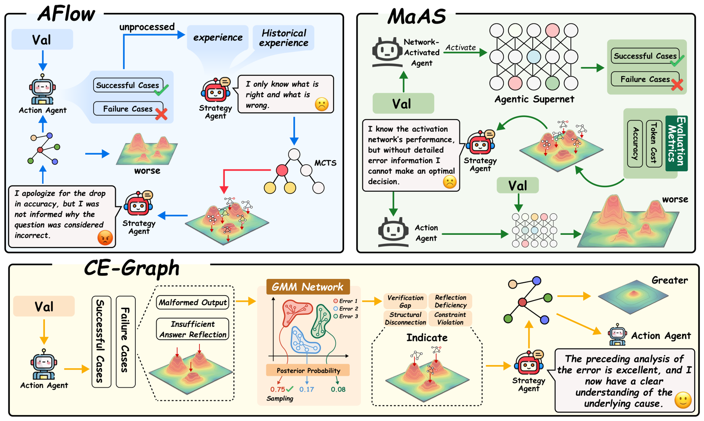

<div align="center">

# CE-Graph

### Failure-Driven Workflow Refinement

**Learn from recurring failures. Propose targeted edits. Verify before committing.**

**Contributors**

[Jusheng Zhang](https://jushengzhang.github.io/), [Kaitong Cai](https://arxiv.org/search/cs?searchtype=author&query=Cai,+K), [Qinglin Zeng](https://arxiv.org/search/cs?searchtype=author&query=Zeng,+Q), [Ningyuan Liu](https://arxiv.org/search/cs?searchtype=author&query=Liu,+N), [Stephen Fan](https://arxiv.org/search/cs?searchtype=author&query=Fan,+S),<br>
Jing Yang, Ziliang Chen, Yongsen Zheng, Kwok-Yan Lam, Liang Lin, Keze Wang

[](https://proceedings.mlr.press/v306/zhang26f.html)
[](https://arxiv.org/abs/2510.10035)
[](https://icml.cc/virtual/2026/spotlight/84846)
[](LICENSE)
[](pyproject.toml)

</div>

> **Contributor acknowledgment:** Qinglin Zeng, Ningyuan Liu, and Stephen Fan also contributed to this work; I apologize for inadvertently omitting them from the initial repository credits, which have now been corrected.

<p align="center"></p>
<p align="center"><sub>Original paper figure. CE-Graph turns execution failures into signals for targeted workflow refinement.</sub></p>

CE-Graph optimizes LLM workflows by examining **how they fail**, rather than treating each run as a single success or failure score. It collects counterexamples, identifies recurring failure modes, proposes constrained graph edits, and accepts edits after verification. The aim is to reduce the workflow's expected failure mass.

This repository releases a **reference implementation** of that loop, task runners, and reproducible commands. It retains the supplied package's reconstruction choices and limitations; it is not an archive of the original paper's complete experiment environment or raw results. See [Implementation scope](#implementation-scope) before comparing scores.

## Contents

- [Overview](#overview)
- [Quick start](#quick-start)
- [Run an experiment](#run-an-experiment)
- [Benchmarks](#benchmarks)
- [Configuration](#configuration)
- [Implementation scope](#implementation-scope)
- [Repository structure](#repository-structure)
- [Citation](#citation)

## Overview

| Stage | What happens | Implementation |
|---|---|---|
| **Collect** | Run the current workflow and retain failed execution traces. | [`counterexamples.py`](verl/ce_graph/counterexamples.py) |
| **Find recurring modes** | Build failure signatures; cluster embeddings with GMM and BIC, with a rule-based fallback. | [`failures.py`](verl/ce_graph/failures.py) |
| **Propose** | Suggest prompt revisions, inserted nodes, or removed nodes. | [`proposer.py`](verl/ce_graph/proposer.py) |
| **Verify & commit** | Evaluate candidate edits on exemplars, accept improvements, and stop on convergence. | [`refine.py`](verl/ce_graph/refine.py) |

Optional extensions include regression checks and Python repair nodes. The standard benchmark driver uses the prompt/graph-edit proposer. The bundled executor processes nodes in list order; it is a lightweight execution model rather than a general parallel DAG engine.

## Quick start

**Python 3.10+**. No GPU is required for the included API-backed runners.

```bash
git clone https://github.com/jushengzhang/CE-Graph.git
cd CE-Graph
python -m venv .venv
source .venv/bin/activate          # Windows: .venv\Scripts\activate
python -m pip install -e .
```

Start with a small **offline demonstration**:

```bash
python -m examples.ce_graph_refine.offline_demo
python -m unittest discover -s tests -v
```

The demo uses synthetic traces and a deterministic operator to show a failure mode being repaired. It makes no network calls and needs no API key. Its scores illustrate control flow; they are not research benchmark results.

## Run an experiment

Configure your own API key and model:

```bash
export OPENROUTER_API_KEY="your-api-key"
export OPENROUTER_MODEL="openai/gpt-4o-mini"
export EMBED_BACKEND="local"
```

Run a small GSM8K experiment and save its report:

```bash
python -m examples.ce_graph_refine.run_all_paper \
  --benchmark gsm8k \
  --train-n 10 --val-n 20 \
  --max-iters 2 --n-proposals 2 --verify-k 4 --patience 2 \
  --n-workers 2 --max-tokens 2048 \
  --save-report runs/gsm8k.json
```

`local` uses hashing features for failure clustering. Switch to `EMBED_BACKEND=openrouter` to use the embedding API. Chat-model and embedding requests use your account and may incur charges.

Reports contain baseline/refined scores, the model, embedding backend, example IDs, refinement decisions, and the resulting workflow. The `train` and `val` arguments name **disjoint refinement/evaluation slices of the loader's selected split**; they do not automatically select a dataset's official train and test splits.

For larger runs, code tasks, and protocol details, see **[Reproduction guide](docs/REPRODUCTION.md)**.

## Benchmarks

| Task | Dataset used by the runner | Evaluation |
|---|---|---|
| GSM8K | `openai/gsm8k` | Numeric answer matching |
| MATH | `EleutherAI/hendrycks_math`, four subjects | Normalized LaTeX string matching |
| MultiArith | `ChilleD/MultiArith` | Numeric answer matching |
| HumanEval | `openai/openai_humaneval` | Python grading tests |
| MBPP | `google-research-datasets/mbpp`, sanitized | Python assertions |
| BBH proxy (`--benchmark gaia`) | Selected `lukaemon/bbh` tasks | Multiple-choice matching |
| AIME 2025 | `MathArena/aime_2025_I` and `MathArena/aime_2025_II` | Integer answer matching |

**The `gaia` option runs a BBH proxy, not the GAIA benchmark.** No measured benchmark scores or model weights are bundled with this release. Use the published paper for its reported results; this repository does not assert numerical reproduction.

## Configuration

| Variable | Default | Purpose |
|---|---|---|
| `OPENROUTER_API_KEY` | Required for API runs | Your provider API key |
| `OPENROUTER_MODEL` | `openai/gpt-4o-mini` | Chat model identifier |
| `OPENROUTER_BASE_URL` | `https://openrouter.ai/api/v1/chat/completions` | Full chat-completions endpoint |
| `EMBED_BACKEND` | `openrouter` | `openrouter`, `openai`, or `local` |
| `EMBED_MODEL` | `text-embedding-3-small` for `openai` mode | Embedding model |
| `EMBED_BASE_URL` | `https://api.openai.com/v1/embeddings` for `openai` mode | Full embeddings endpoint |

To use another OpenAI-compatible provider, set its full endpoint and model ID. The legacy variable name `OPENROUTER_API_KEY` is also used for that provider's key and for remote embeddings. `.env.example` lists the settings; export them in your shell rather than committing credentials.

## Implementation scope

- **Reference release.** The provided archive reconstructs the method and a MaAS-style baseline. Matching the paper requires aligning splits, prompts, model versions, token budgets, and graders.
- **Evaluation visibility.** `--maas` selects the reconstructed workflow architecture. It does **not** expose full grading tests. `--expose-public-tests` explicitly enables a test-visible diagnostic run, which is labeled in its report and must not be presented as hidden-test benchmark accuracy. MBPP retains the runner's single visible example assertion.
- **Code execution.** HumanEval, MBPP, and Python repair nodes execute generated code in local subprocesses. Timeouts are not security isolation; run these experiments in a disposable environment without unrelated secrets.
- **Protocol differences.** MATH uses a balanced four-subject slice and string matching rather than symbolic equivalence; BBH is only a reasoning proxy. The offline hashing fallback differs from semantic API embeddings.
- **Reported results.** Report every seed and selection rule. Do not select a best seed on the evaluation set and describe it as a single-seed reproduction.

## Repository structure

```text
CE-Graph/
├── assets/readme/                 # Original paper figure and provenance
├── verl/ce_graph/                 # Workflow, executor, clustering, proposer, refinement
├── examples/ce_graph_refine/      # Benchmark runners and offline demo
├── docs/REPRODUCTION.md           # Commands and evaluation protocol
├── tests/                        # Offline regression tests
├── scripts/check.sh             # Offline validation without API keys
├── CITATION.cff
├── pyproject.toml
└── LICENSE
```

The `verl.ce_graph` import path is preserved from the supplied release. This is a standalone lightweight package, not the full verl reinforcement-learning framework; use a separate virtual environment if you also work with upstream verl.

## Citation

Please cite the published paper:

```bibtex
@InProceedings{pmlr-v306-zhang26f,
  title     = {Failure-Driven Workflow Refinement},
  author    = {Zhang, Jusheng and Cai, Kaitong and Yang, Jing and Chen, Ziliang and
               Zheng, Yongsen and Lam, Kwok-Yan and Lin, Liang and Wang, Keze},
  booktitle = {Proceedings of the 43rd International Conference on Machine Learning},
  pages     = {154214--154240},
  year      = {2026},
  volume    = {306},
  series    = {Proceedings of Machine Learning Research},
  publisher = {PMLR},
  url       = {https://proceedings.mlr.press/v306/zhang26f.html}
}
```

The earlier arXiv version has a different author list; the metadata above follows the published PMLR version.

## License & acknowledgments

Code is released under the **[Apache License 2.0](LICENSE)** included in the supplied archive. Datasets remain subject to their own terms. The original paper figure is attributed in [assets/readme/README.md](assets/readme/README.md).

The reconstructed MaAS-style workflow is described in the [reproduction guide](docs/REPRODUCTION.md). README presentation was inspired by [UMM-Reflection](https://github.com/waltstephen/UMM-Reflection); its code, results, and visual assets are not included here.
